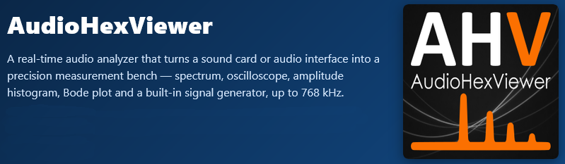
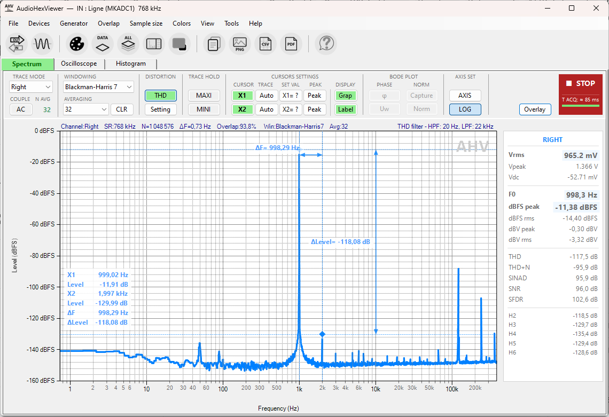
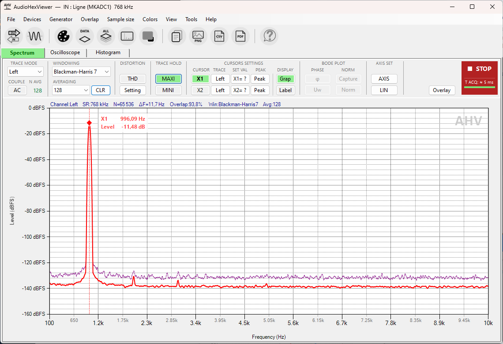
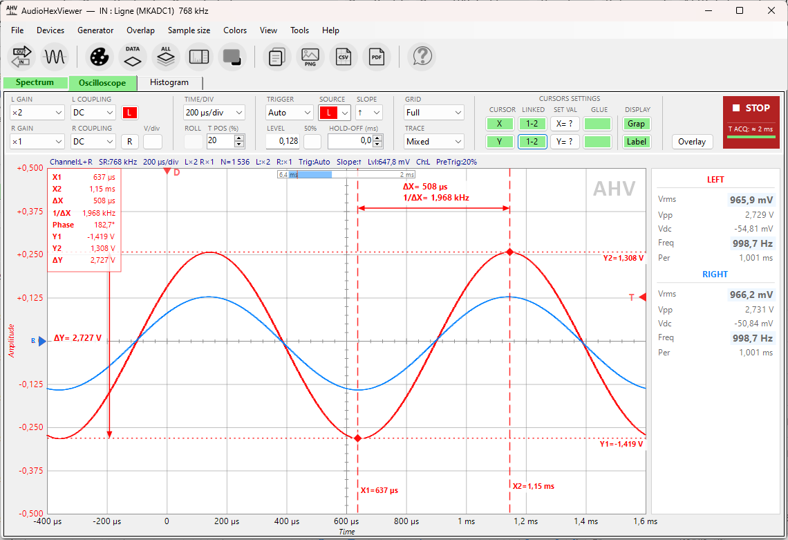
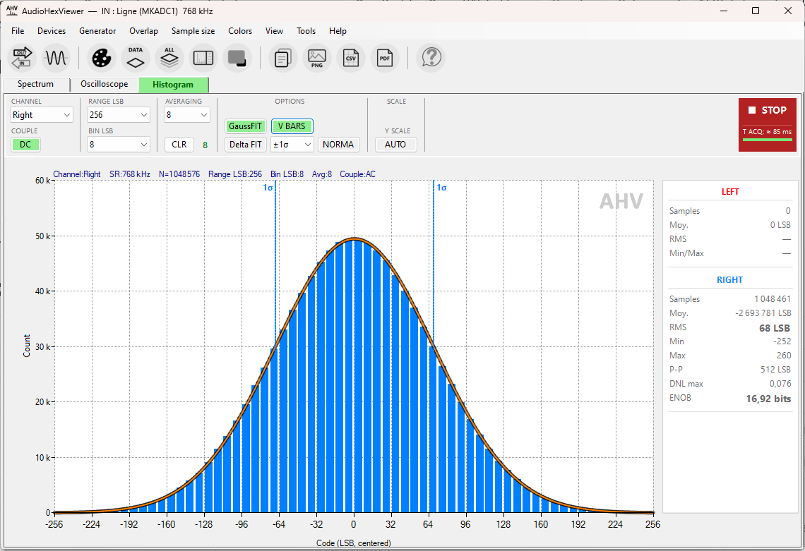
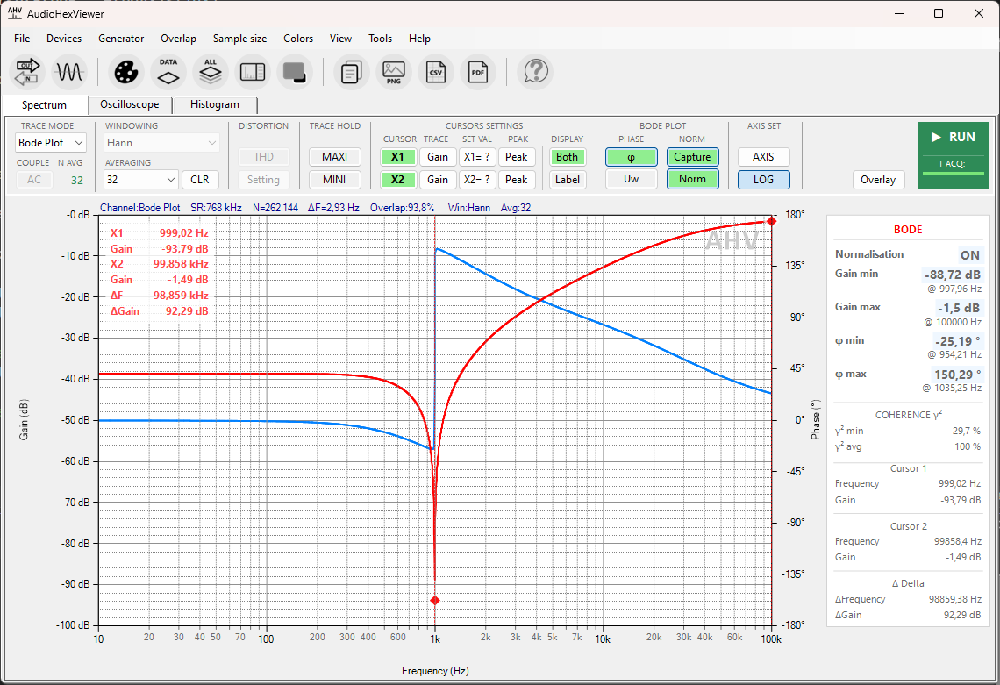

<p align="center">
  
</p>

<p align="center">
  <a href="LICENSE"></a>
  
  
  
</p>

<p align="center">
  
</p>

---

## What is it?

AudioHexViewer is a real-time audio analyzer for Windows and a measurement tool for the DIY audio and electronics community. It captures audio through WASAPI — including exclusive, bit-perfect mode — and turns a plain sound card or audio interface into a multi-instrument bench for characterizing ADCs, DACs, amplifiers and complete signal chains, with the kind of readouts usually reserved for dedicated lab gear: spectrum, oscilloscope, amplitude histogram, Bode plot and a built-in signal generator, up to **768 kHz**.

It was originally created to test hardware acquisition platforms under development — as a continuation of the **OSVA** audio project — and grew into a general-purpose, high-resolution analyzer, released free and open source. 

---

## Key features & differentiators

| | |
|---|---|
| **Up to 768 kHz** — WASAPI exclusive mode for bit-perfect capture | **Professional metrics** — THD, THD+N, SINAD, SNR, SFDR, IMD, noise floor and more... |
| **FFT up to 4 Mpts** — linear, exponential or coherent averaging | **Bode plot with reference** — gain & phase, with save/reload of reference responses |
| **Built-in generator** — 11 signals, a **loopback** self-test mode, voltage-calibratable | **Amplitude histogram** — Gaussian overlay, σ markers, PDF normalization, DNL |
| **Overlays** — record, save & compare reference traces across sessions | **Offline analysis mode** — load a WAV file and run the full analysis chain |
| **Level calibration** — map dBFS to real volts, for analyzer *and* generator | **Live numeric readout** — sample values in decimal, float, binary and hexadecimal |
| **Peak & cursors** — MAXI / MINI (max-hold / min-hold) and cursors with in-graph values | **Export & customize** — CSV data & PDF graph export, fully customizable colours |


> Enable **context-sensitive tooltips** from the toolbar and hover over any control — each button, combo and field then shows a short explanation of what it does, so you can get to grips with the program quickly.

---

## Screenshots at a glance

<table>
  <tr>
    <td width="50%"><br><sub><b>Spectrum</b> — FFT with MAXI peak-hold and noise floor</sub></td>
    <td width="50%"><br><sub><b>Oscilloscope</b> — trigger &amp; cursors</sub></td>
  </tr>
  <tr>
    <td><br><sub><b>Histogram</b> — Gaussian fit &amp; σ markers</sub></td>
    <td><br><sub><b>Bode plot</b> — gain &amp; phase vs. frequency (Twin-T filter)</sub></td>
  </tr>
</table>

> 📖 Full user documentation: [`doc/documentation.html`](AudioHexViewer/doc/documentation.html)

---

## Requirements

**To run** (end users): **Windows 10 or 11, 64-bit**. Each release provides two builds, each packaged as a ready-to-use folder — executable + documentation + context-help data — inside a ZIP archive:

- **Standalone** (recommended) — nothing else to install; the executable bundles the .NET runtime (larger download).
- **Runtime-required** — a much smaller executable that requires the **[.NET 10 Desktop Runtime (x64)](https://dotnet.microsoft.com/download/dotnet/10.0)** to be installed on the machine.

If in doubt, take the **standalone** build — it always works.

**To build** (developers): the **.NET 10 SDK** (Windows). The project targets `net10.0-windows` and uses Windows Forms, so it builds and runs on Windows only.

---

## Installation (end users)

1. Go to the [**Releases**](https://github.com/OneAudio/AudioHexViewer/releases) page and download **one** of the two ZIP archives from the latest release:
   - `AudioHexViewer-vX.Y.Z-win-x64-standalone.zip` — **recommended**, works out of the box.
   - `AudioHexViewer-vX.Y.Z-win-x64-runtime-required.zip` — smaller, but needs the [.NET 10 Desktop Runtime (x64)](https://dotnet.microsoft.com/download/dotnet/10.0) installed.
2. (Recommended) Verify the download against the published **SHA-256** checksum (the matching `.sha256.txt` file is attached to the release).
3. **Extract the ZIP.** You get an `AudioHexViewer/` folder containing the executable, `ContextHelp.json` (in-app tooltips) and a `doc/` folder (the full HTML documentation).
4. Run **`AudioHexViewer.exe`** from that folder. No installer, no admin rights required.

> **Keep the folder together.** The executable reads `ContextHelp.json` and the `doc/` folder from beside it — moving the `.exe` out on its own disables the in-app tooltips and the local documentation link. Copy or move the whole folder.

> **SmartScreen / antivirus note.** The executable is **not code-signed** (this is a free, open-source project). On first launch, Windows SmartScreen may show *"Windows protected your PC"* — click **More info → Run anyway**. Some antivirus engines may also flag self-contained single-file executables; this is a known false positive for unsigned bundled-runtime apps. If in doubt, verify the SHA-256 checksum and/or build from source.

---

## Building from source

```bash
# Clone
git clone https://github.com/OneAudio/AudioHexViewer.git
cd AudioHexViewer

# Restore + build (Debug)
dotnet build AudioHexViewer/AudioHexViewer.csproj

# Run
dotnet run --project AudioHexViewer/AudioHexViewer.csproj
```

To produce the release executables:

```bash
# Standalone (self-contained, bundles the .NET runtime) — uses the .csproj settings
dotnet publish AudioHexViewer/AudioHexViewer.csproj -c Release

# Runtime-required (framework-dependent, needs the .NET 10 Desktop Runtime)
dotnet publish AudioHexViewer/AudioHexViewer.csproj -c Release --self-contained false
```

The default publish settings (`win-x64`, self-contained, single file) are defined in the `.csproj`; the runtime-required variant simply overrides `--self-contained false`. The output is in `AudioHexViewer/bin/Release/net10.0-windows/win-x64/publish/` — the executable alongside `ContextHelp.json` and the `doc/` folder, i.e. the same layout the release ZIP provides. (The release workflow packages both variants automatically on a version tag.)

---

## Running the tests

The solution includes an xUnit test project (`AudioHexViewer.Tests`) covering the DSP core — **~130 test cases** across `DspMath`, `RingBufferStereoFloat`, `FftPipelineController`, `SpectrumMetrics` and `WindowFactory`.

```bash
dotnet test
```

---

## Project layout

```
AudioHexViewer/
├── Core/            # DSP core: FFT pipeline, ring buffer, window functions, stats
├── Analysis/        # Spectrum metrics, test waveforms
├── Overlays/        # Reference-trace library and management
├── Form1.*.cs       # Main window (partial classes: capture, FFT, toolbar, signals…)
├── SpectrumControl.*.cs    # Spectrum view (rendering, cursors, overlays, Bode…)
├── OscilloscopeControl.cs  # Oscilloscope view
├── HistogramControl.cs     # Amplitude histogram view
└── …                # Dialogs, export, calibration, generator
AudioHexViewer.Tests/        # xUnit test suite (DSP core)
```

User data is stored outside the application folder:

- Session settings — `%APPDATA%\AudioHexViewer\`
- Calibration — `%LOCALAPPDATA%\AudioHexViewer\`
- Overlays — `Documents\AudioHexViewer\Overlays\`

---

## Built with

- [NAudio](https://github.com/naudio/NAudio) — audio capture/playback (MIT)
- [Math.NET Numerics](https://numerics.mathdotnet.com/) — FFT and numerics (MIT)
- [WinForms.DataVisualization](https://github.com/dotnet/winforms-datavisualization) — charting

Full third-party license notices are in [`THIRD-PARTY-NOTICES.md`](THIRD-PARTY-NOTICES.md).

---

## Contributing

Contributions are welcome. A few conventions for this codebase:

- **In-app strings are in English.**
- No dead code — remove rather than comment out.
- Keep changes focused; prefer small, surgical diffs.
- Run `dotnet test` before opening a pull request.

See [`CONTRIBUTING.md`](CONTRIBUTING.md) for details (issues, build setup, coding style).

---

## License

AudioHexViewer is free software, licensed under the **GNU General Public License v3.0 or later**. See [`LICENSE`](LICENSE) for the full text.

```
Copyright (C) 2026  Frex (OnE Audio Projects)

This program is free software: you can redistribute it and/or modify
it under the terms of the GNU General Public License as published by
the Free Software Foundation, either version 3 of the License, or
(at your option) any later version.
```
